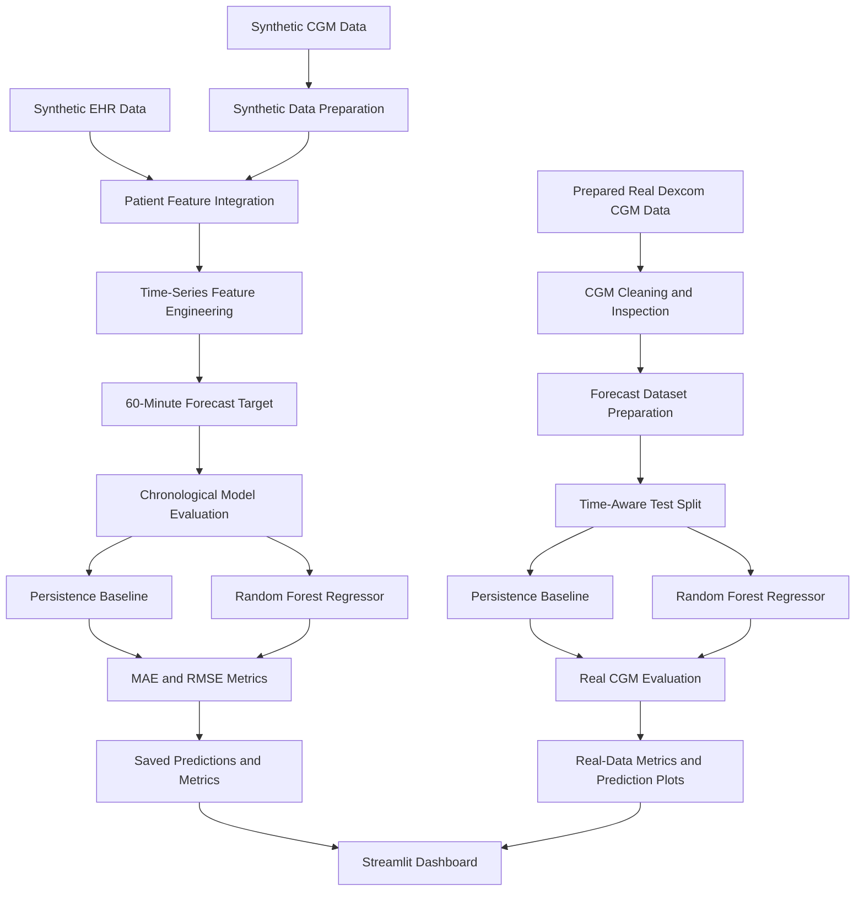

# GlucoTwin AI — System Architecture

## 1. Overview

GlucoTwin AI is an educational proof of concept that explores patient-state representation and short-horizon glucose forecasting using synthetic Electronic Health Record (EHR) data and Continuous Glucose Monitoring (CGM) time series.

The application provides two separate workflows:

- **Synthetic patient workflow:** Demonstrates synthetic EHR and CGM integration, glucose forecasting, and dashboard visualization.
- **Real CGM workflow:** Evaluates forecasting models on prepared CGM data from one participant.

These workflows are evaluated separately. The real CGM experiment is not linked to the synthetic EHR records as a real patient.

## 2. Architecture Diagram

## 3. Component Description

| Component | Responsibility |
|---|---|
| Data preparation | Loads and prepares synthetic or real CGM data |
| Synthetic EHR | Supplies generated patient attributes for the synthetic experiment |
| Feature engineering | Creates recent-glucose features and forecasting targets |
| Forecasting model | Uses a Random Forest regressor to estimate future glucose |
| Baseline model | Uses the current glucose reading as the future estimate |
| Evaluation | Calculates MAE and RMSE on held-out test samples |
| Outputs | Stores experiment metrics, predictions, and plots |
| Streamlit dashboard | Presents patient overview, glucose history, forecasts, and evaluation |

## 4. Forecasting Workflow

The forecasting workflow uses recent glucose readings to estimate glucose approximately 60 minutes into the future.

1. Load and inspect the data.
2. Prepare timestamped glucose readings.
3. Construct historical glucose features.
4. Define the future glucose target.
5. Separate training and testing periods chronologically.
6. Evaluate a persistence baseline and Random Forest model.
7. Save prediction records and evaluation metrics.
8. Display results in the Streamlit dashboard.

## 5. Evaluation Metrics

- **Mean Absolute Error (MAE):** Average absolute difference between predicted and observed glucose.
- **Root Mean Squared Error (RMSE):** Penalizes larger prediction errors more heavily.
- **Persistence baseline:** Predicts future glucose using the current reading.

Lower MAE and RMSE indicate smaller errors on the evaluated dataset.

## 6. Current Real CGM Results

The current recorded experiment uses one participant's CGM data.

| Model | MAE (mg/dL) | RMSE (mg/dL) |
|---|---:|---:|
| Persistence baseline | 9.431 | 14.156 |
| Random Forest | 10.266 | 14.152 |

The Random Forest model has a higher MAE and a marginally lower RMSE than the persistence baseline. It does not outperform the baseline on both metrics.

These results are exploratory and do not establish clinical validity or generalization to other participants.

## 7. Technology Stack

- Python
- Pandas and NumPy
- Scikit-learn
- Matplotlib
- Streamlit
- CSV-based data storage
- Git and GitHub

## 8. Limitations and Responsible Use

- Synthetic records are generated for demonstration.
- The real CGM experiment uses data from one participant.
- Synthetic EHR data is not a clinically matched record for the real CGM participant.
- The current experiment does not demonstrate clinical forecasting accuracy.
- External validation on additional participants is required.
- The system is not intended for diagnosis, treatment, or medical decision-making.

## 9. Future Improvements

- Evaluate across multiple independent participants.
- Improve time-series validation and model selection.
- Explore uncertainty estimation and prediction intervals.
- Test additional forecasting approaches.
- Improve missing-data handling and robustness.
- Add authorized and appropriately validated clinical context where available.

---

**Project:** GlucoTwin AI  
**Repository:** https://github.com/MollyKhandelwal/GlucoTwin-AI  
**Purpose:** Educational digital-twin-inspired glucose forecasting prototype.
